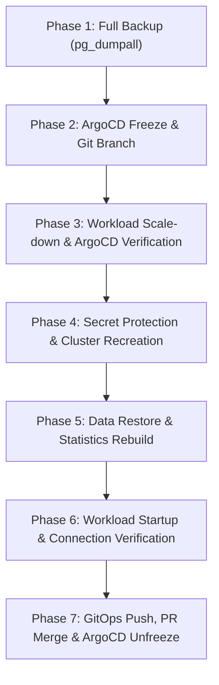

# PostgreSQL Major Version Upgrade Runbook (CloudNativePG)

This runbook documents the step-by-step procedure for performing a **major version upgrade** (e.g., PostgreSQL 16 → 17, 17 → 18) for the personal homelab CloudNativePG cluster.

---

## Architecture & Invariants

* **Cluster Name**: `postgres` (namespace: `cloudnative-pg`)
* **Storage**: `longhorn-strict-local` (3 instances, 30Gi each with strict node affinity)
* **Access Endpoints**: Consumer applications connect to `postgres-rw.cloudnative-pg.svc.cluster.local:5432`
* **Credentials**: Mirrored to consumer namespaces by Emberstack Reflector via the `postgres-superuser` secret.
* **Why this procedure is required**: Major PostgreSQL releases have incompatible on-disk data formats. You cannot simply update the container image on an existing data directory. The data must be logically dumped, the old cluster storage retired, a fresh cluster provisioned with the new PostgreSQL version, and the data restored.
* **Advantage of this approach**: By keeping the cluster name and service name identical, **zero configuration changes** are required across consumer applications.

---

## Overview Workflow



---

## Phase 1: Pre-Upgrade Safety Backup (Non-disruptive)

> [!NOTE]
> Run `pg_dumpall` **directly inside the pod** to a local file before copying to the host. Streaming large dumps directly over `kubectl exec` network pipes can suffer from silent premature connection termination.

1. **Dump inside primary pod**:
   ```bash
   kubectl exec -n cloudnative-pg postgres-1 -c postgres -- sh -c \
     'pg_dumpall -U postgres | gzip > /var/lib/postgresql/data/backup_pre_upgrade.sql.gz'
   ```

2. **Copy backup to local machine**:
   ```bash
   kubectl cp cloudnative-pg/postgres-1:var/lib/postgresql/data/backup_pre_upgrade.sql.gz ./postgres_backup_pre_upgrade.sql.gz
   ```

3. **Validate backup integrity & contents**:
   ```bash
   # Check size
   ls -lh ./postgres_backup_pre_upgrade.sql.gz

   # Verify archive integrity
   gzip -t ./postgres_backup_pre_upgrade.sql.gz

   # Confirm cluster dump completed successfully
   zcat ./postgres_backup_pre_upgrade.sql.gz | tail -n 5

   # Verify all databases are present in the dump
   zcat ./postgres_backup_pre_upgrade.sql.gz | grep "^CREATE DATABASE "
   ```

---

## Phase 2: ArgoCD Freeze & Git Branching

1. **Create a dedicated feature branch**:
   ```bash
   git checkout -b feature/postgres-<NEW_VERSION>-upgrade
   ```

2. **Disable ArgoCD auto-sync & self-heal**:
   Temporarily disengage ArgoCD on the `database` application and all consumer applications:
   ```bash
   for app in database home-assistant media-flix n8n affine nbot vaultwarden; do
     kubectl patch app "$app" -n argocd --type merge -p '{"spec":{"syncPolicy":null}}'
   done
   ```

3. **Validate ArgoCD sync policy is cleared**:
   ```bash
   kubectl get app database -n argocd -o jsonpath='{.spec.syncPolicy.automated}'
   ```
   *(Must output empty or null)*

---

## Phase 3: Workload Scale-Down & ArgoCD Verification

> [!IMPORTANT]
> **Crucial Learning**: Always wait **20–30 seconds** after scaling workloads to 0 and explicitly check that ArgoCD self-heal has not restored the pods before proceeding to database teardown!

1. **Scale consumer workloads to 0**:
   ```bash
   kubectl scale deployment home-assistant -n home-assistant --replicas=0
   kubectl scale deployment n8n -n n8n --replicas=0
   kubectl scale deployment affine -n affine --replicas=0
   kubectl scale deployment nbot -n nbot --replicas=0
   kubectl scale deployment sonarr radarr prowlarr lidarr -n media-flix --replicas=0
   kubectl scale statefulset vaultwarden -n vaultwarden --replicas=0
   ```

2. **Wait and verify workloads stay at 0**:
   ```bash
   # Sleep 20 seconds to allow any background ArgoCD sync cycles to trigger
   sleep 20

   # Confirm 0 pods running for consumer workloads
   kubectl get pods -n home-assistant -n n8n -n affine -n nbot -n media-flix -n vaultwarden \
     -l 'app.kubernetes.io/name in (home-assistant,n8n,affine,nbot,sonarr,radarr,prowlarr,lidarr,vaultwarden)'
   ```
   *(If pods restarted, ensure `selfHeal: null` is properly set on that application's ArgoCD resource).*

3. **Take final consistent snapshot (zero active writers)**:
   ```bash
   kubectl exec -n cloudnative-pg postgres-1 -c postgres -- sh -c \
     'pg_dumpall -U postgres | gzip > /var/lib/postgresql/data/backup_final.sql.gz'
   kubectl cp cloudnative-pg/postgres-1:var/lib/postgresql/data/backup_final.sql.gz ./postgres_backup_final.sql.gz

   # Verify final dump footer
   zcat ./postgres_backup_final.sql.gz | tail -n 5
   ```

---

## Phase 4: Secret Protection & Cluster Recreation

> [!WARNING]
> **Crucial Learning**: CNPG cluster secrets (`postgres-superuser`, `postgres-app`) have `ownerReferences` pointing to the `Cluster` resource. Deleting the cluster will trigger Kubernetes garbage collection to delete these secrets and break application authentication! You must strip `ownerReferences` before deleting the cluster.

1. **Back up and decouple credentials from garbage collection**:
   ```bash
   # Back up secrets locally
   kubectl get secret postgres-superuser -n cloudnative-pg -o yaml > ./secret_postgres_superuser_backup.yaml
   kubectl get secret postgres-app -n cloudnative-pg -o yaml > ./secret_postgres_app_backup.yaml

   # Remove ownerReferences
   kubectl patch secret postgres-superuser -n cloudnative-pg --type json -p '[{"op":"remove","path":"/metadata/ownerReferences"}]'
   kubectl patch secret postgres-app -n cloudnative-pg --type json -p '[{"op":"remove","path":"/metadata/ownerReferences"}]'
   ```

2. **Update cluster manifests**:
   In `k8s/05_cluster-features/01_database/postgres-cluster/cluster.yaml`:
   * Update `imageName` to the new version (e.g. `ghcr.io/cloudnative-pg/postgresql:18`).
   * Ensure `superuserSecret.name: postgres-superuser` is uncommented.
   * Ensure `k8s/05_cluster-features/01_database/postgres-cluster/kustomization.yaml` declares `namespace: cloudnative-pg`.

3. **Delete old PG cluster and storage**:
   ```bash
   kubectl delete cluster postgres -n cloudnative-pg
   kubectl delete pvc postgres-1 postgres-2 postgres-3 -n cloudnative-pg --wait=false
   ```
   *(If `postgres-1` pod hangs in `Terminating` due to its 1800s termination grace period, force terminate it: `kubectl delete pod postgres-1 -n cloudnative-pg --grace-period=0 --force`).*

4. **Deploy new PostgreSQL cluster**:
   ```bash
   kubectl apply -k k8s/05_cluster-features/01_database/postgres-cluster -n cloudnative-pg
   ```

5. **Wait for primary pod to become Ready**:
   ```bash
   kubectl wait --namespace cloudnative-pg --for=condition=Ready pod/postgres-1 --timeout=180s

   # Verify running version
   kubectl exec -n cloudnative-pg postgres-1 -c postgres -- psql --version
   ```

---

## Phase 5: Data Restore & Statistics Optimization

1. **Copy backup to new primary pod**:
   ```bash
   kubectl cp ./postgres_backup_final.sql.gz cloudnative-pg/postgres-1:var/lib/postgresql/data/restore.sql.gz
   ```

2. **Execute restore**:
   ```bash
   kubectl exec -n cloudnative-pg postgres-1 -c postgres -- sh -c \
     'zcat /var/lib/postgresql/data/restore.sql.gz | psql -U postgres -d postgres -q'
   ```
   *(Notices that roles like `postgres` or `app` already exist are normal and safe to ignore).*

3. **Rebuild optimizer statistics**:
   ```bash
   kubectl exec -n cloudnative-pg postgres-1 -c postgres -- vacuumdb -U postgres --all --analyze
   ```

4. **Clean up restore file inside pod**:
   ```bash
   kubectl exec -n cloudnative-pg postgres-1 -c postgres -- rm -f /var/lib/postgresql/data/restore.sql.gz
   ```

5. **Validate restored databases and cluster status**:
   ```bash
   # List databases and sizes
   kubectl exec -n cloudnative-pg postgres-1 -c postgres -- psql -U postgres -d postgres -c "\l+"

   # Check cluster health (expect 3/3 ready instances)
   kubectl get cluster postgres -n cloudnative-pg
   ```

---

## Phase 6: Restore Consumer Workloads & Verify Connections

1. **Scale workloads back to 1 replica**:
   ```bash
   kubectl scale deployment home-assistant -n home-assistant --replicas=1
   kubectl scale deployment n8n -n n8n --replicas=1
   kubectl scale deployment affine -n affine --replicas=1
   kubectl scale deployment nbot -n nbot --replicas=1
   kubectl scale deployment sonarr radarr prowlarr lidarr -n media-flix --replicas=1
   kubectl scale statefulset vaultwarden -n vaultwarden --replicas=1
   ```

2. **Verify active database connections**:
   ```bash
   kubectl exec -n cloudnative-pg postgres-1 -c postgres -- psql -U postgres -d postgres -c \
     "SELECT datname, COALESCE(application_name, 'internal'), count(*) FROM pg_stat_activity GROUP BY 1, 2 ORDER BY 1, 2;"
   ```
   Confirm all databases have active client connections established.

---

## Phase 7: GitOps Finalization

1. **Ensure backup files are ignored**:
   Ensure `.gitignore` contains:
   ```gitignore
   *.sql.gz
   secret_*_backup.yaml
   ```

2. **Commit and push changes**:
   ```bash
   git add k8s/05_cluster-features/01_database/postgres-cluster/
   git commit -m "chore(database): upgrade postgresql cluster to v<VERSION>"
   git push -u origin feature/postgres-<NEW_VERSION>-upgrade
   ```

3. **Re-enable ArgoCD auto-sync and self-heal**:
   ```bash
   for app in database home-assistant media-flix n8n affine nbot vaultwarden; do
     kubectl patch app "$app" -n argocd --type merge -p '{"spec":{"syncPolicy":{"automated":{"prune":true,"selfHeal":true}}}}'
   done
   ```

4. **Merge PR & Return to `main`**:
   Once the GitHub PR is merged, update your local branch:
   ```bash
   git checkout main
   git pull
   ```

---

## Key Gotchas & Troubleshooting Reference

| Symptom / Issue | Cause | Solution |
| :--- | :--- | :--- |
| **ArgoCD restores scaled pods** | Application self-heal was not disabled or reconciled from parent app. | Ensure `spec.syncPolicy: null` is patched on all consumer apps; sleep 20s and verify pod counts remain 0 before proceeding. |
| **Passwords lost / apps get Auth Failed** | `postgres-superuser` was deleted by garbage collection when `Cluster` was deleted. | Always patch secrets to remove `metadata.ownerReferences` before running `kubectl delete cluster`. |
| **Pod stuck terminating** | Pod termination grace period is 1800s in CNPG. | Force delete: `kubectl delete pod postgres-1 -n cloudnative-pg --grace-period=0 --force`. |
| **Cluster created in `default` namespace** | `kustomization.yaml` omitted `namespace: cloudnative-pg`. | Always ensure `namespace: cloudnative-pg` is specified in `kustomization.yaml`. |
| **Dump file cut off halfway** | Network pipe drop during `kubectl exec ... \| gzip > host.gz`. | Always execute the dump directly to `/var/lib/postgresql/data/` inside the pod, then copy with `kubectl cp`. |
